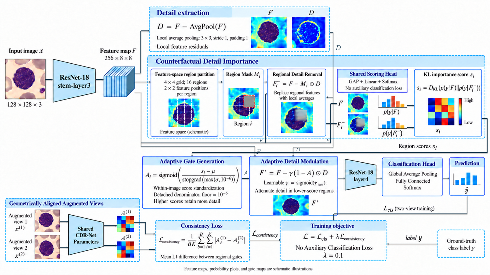

# CDR-Net Supplementary Materials

Supplementary training code for ResNet-18 comparisons (Tables 2 and 3) and controlled CDR ablations (Tables 4 and 5). CDR stands for **Counterfactual Detail Reliability**.

## Method overview



CDR operates on the ResNet-18 layer3 feature map. It extracts local detail residuals, measures the effect of removing regional details with a shared scoring head, and uses KL divergence to generate regional reliability gates. Detail modulation attenuates lower-score regions before layer4 and the classification head. Training combines classification loss on two geometrically aligned color views with an L1 gate-consistency loss. The full CDR configuration uses no auxiliary classification loss.

## Contents

| Directory | Contents |
| --- | --- |
| [Table 2 and Table 3](./Table%202%20and%20Table%203/readme.md) | 12 independent scripts for CDR and comparison methods. |
| [Table 4 and Table 5](./Table%204%20and%20Table%205/readme.md) | 6 scripts for the full CDR model and controlled ablations. |
| [official document](./official%20document/readme.md) | ResNet-18 checkpoint download instructions and a RandStainNA LAB statistics YAML file. |

Each script is self-contained and stores its experiment settings near the top. Dataset images and completed experiment results are not included.

## Environment

Use Python 3.9 or newer and mutually compatible versions of PyTorch and torchvision that support `torch.autocast` and `torch.load(..., weights_only=True)`. A CUDA-capable GPU is recommended; the scripts also select CPU when CUDA is unavailable.

```bash
python -m pip install torch torchvision numpy matplotlib pillow tqdm
```

For CUDA, install the matching PyTorch/torchvision build for your system. Optional `scikit-learn` enables multiclass macro AUC reporting in the CDR scripts:

```bash
python -m pip install scikit-learn
```

RandStainNA additionally requires its official repository and that repository's dependencies. Excel reports use Python's standard-library ZIP/XML writer and require no Excel package.

## Prepare the data

All scripts load three local splits with `torchvision.datasets.ImageFolder`. Each split must contain the same class directory names and class-to-index mapping:

```text
dataset/
  train/
    class_0/image_001.png
    class_1/image_002.png
  val/
    class_0/image_003.png
    class_1/image_004.png
  test/
    class_0/image_005.png
    class_1/image_006.png
```

Use distinct training, validation, and test directories. For medical datasets, establish patient/lesion-level independence during dataset preparation. The class count is inferred from the training folders.

## Configure paths and run

Replace each `r"......."` placeholder at the top of the selected script before running it:

```python
TRAIN_DIR = r"......."  # Training split containing one subfolder per class.
VAL_DIR = r"......."  # Independent validation split with the same class folders.
TEST_DIR = r"......."  # Held-out test split with the same class folders.
RESNET18_WEIGHTS_PATH = r"......."  # Local pretrained ResNet18 .pth file.
SAVE_DIR = r"......."  # Unique output directory for this method, dataset, and seed.
```

The dots are placeholders, not usable paths. For example, use `TRAIN_DIR = r"D:\datasets\my_dataset\train"` on Windows, or `TRAIN_DIR = r"/data/my_dataset/train"` on Linux. The `r` prefix preserves literal backslashes.

Pretrained weights are not included in this repository. Download the official torchvision ResNet-18 ImageNet-1K weights from [resnet18-f37072fd.pth](https://download.pytorch.org/models/resnet18-f37072fd.pth) (`ResNet18_Weights.IMAGENET1K_V1`), save the file locally, and set `RESNET18_WEIGHTS_PATH` to its actual path. For example, after saving it in `official document/`, use:

```python
RESNET18_WEIGHTS_PATH = r"official document/resnet18-f37072fd.pth"
```

This relative path assumes execution from the repository root; an absolute path also works. The training scripts load local weights and do not download them automatically.

For RandStainNA, also set `RANDSTAIN_OFFICIAL_REPO` and `RANDSTAIN_YAML`; those settings are only used by the RandStainNA method. See the [resource instructions](./official%20document/readme.md).

Run a script from the repository root:

```bash
python "Table 2 and Table 3/train_cdr_full.py"
python "Table 2 and Table 3/train_resnet18_basic.py"
python "Table 4 and Table 5/train_cdr_no_stability.py"
```

Default settings are seed 42, image size 128, batch size 8, 30 epochs, backbone learning rate `1e-4`, new-module learning rate `5e-4`, and weight decay `1e-4`. Review these settings for each dataset and trial. Set `NUM_WORKERS = 0` if multiprocessing causes problems. Use a distinct `SAVE_DIR` for every experiment. To resume an interrupted run, keep the same configuration/output directory and set `RESUME = True`.

## Outputs and evaluation

Each run writes training logs, dataset/class metadata, training plots, a resumable `last_checkpoint.pth`, ten independently tracked best checkpoints, JSON summaries, per-class CSV reports, and an English Excel workbook into `SAVE_DIR`. CDR runs also report gate diagnostics and, when available, macro AUC for the validation-loss-selected checkpoint.

Five selection criteria are tracked separately on validation and test: maximum accuracy, macro F1, macro recall, and macro precision, and minimum cross-entropy loss. Multiple criteria can select the same epoch.

**Use validation-selected checkpoints for the reported held-out test results.** The five test-selected checkpoints are diagnostic outputs: choosing an epoch using test performance introduces selection bias. Keep the checkpoint-selection rule fixed when comparing methods.

Accuracy is stored as a percentage. Macro precision, recall, and F1 are ratios in JSON/CSV summaries and are converted to percentages in the Excel report. Loss is dimensionless. Macro metrics use an unweighted average across classes, with zero denominators producing zero scores.

## Implementation notes

The folder READMEs describe each method and ablation. AugMix uses a local PIL-based reimplementation. WARN and MSWA are paper-informed ResNet-18 adaptations, as indicated in their source code. RandStainNA imports its transform from a separately downloaded official repository. The full CDR script appears in both experiment folders for independent use.

## GitHub image display

The method diagram is embedded above using ``. Upload both this `ReadMe.md` and `method.PNG` to the same repository root, keeping the exact filename capitalization. GitHub will render the diagram on the repository README page.
